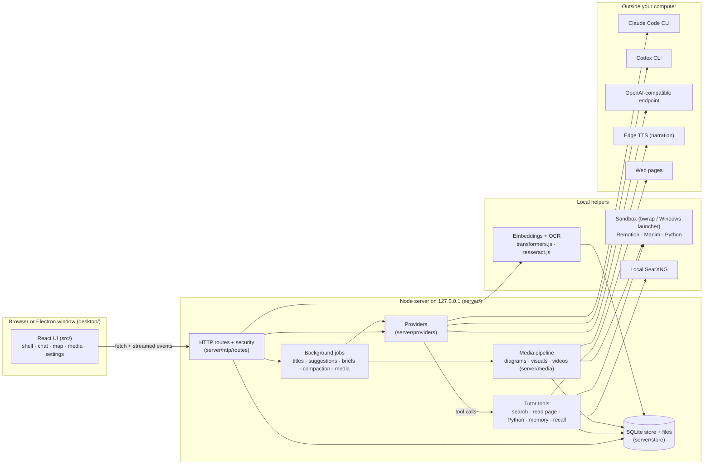

<p align="center"></p>

# Rabbithole

A local learning workspace where every side question gets its own branch.

[](https://github.com/Thomastienn/Rabbithole/releases/latest/download/Rabbithole-linux-x86_64.AppImage)
[](https://github.com/Thomastienn/Rabbithole/releases/latest/download/Rabbithole-windows-x64-setup.exe)

Windows warns on first run because the installers are unsigned. See [Desktop app](#desktop-app).

Ask a question, highlight a passage you don't understand, and explore it in a child conversation. The original thread stays intact, and every conversation shows up as a box on a map you can pan, fold and come back to. Everything runs and saves on your computer.

https://github.com/user-attachments/assets/bdd3add1-b358-472a-903a-9716c0718048

## Features

- Branch from any passage in a reply. The child gets that passage plus a compact snapshot of its parent's context, and branches nest to any depth.
- A learning tree map beside the chat, with pan, zoom, drag and fold.
- Claude (default) and Codex through their official CLIs and your existing plans, or any OpenAI-compatible endpoint. You can switch models mid-conversation and keep the history.
- Interactive visuals, Mermaid diagrams and narrated videos, rendered locally.
- Tutor tools for web search, page reading, image finding and offline Python, plus a memory note that carries across trees.
- Image, PDF and text attachments, with local OCR for models that can't read images.
- Full keyboard control, with optional Vim bindings.

## Quick start

You need [Node.js 24+](https://nodejs.org/) with npm.

```sh
git clone https://github.com/Thomastienn/Rabbithole.git
cd Rabbithole
npm start
```

The first run installs dependencies, sets up the video tools and a local search instance, and builds the app, so it needs internet access. Rabbithole then opens at http://127.0.0.1:4317. Later starts reuse that setup. Stop it with Ctrl+C.

```sh
npm run serve                # start without opening a browser
npm start -- --port 4318     # use another port (or set RABBITHOLE_PORT)
```

On macOS, startup checks for Cairo and Pango and prints the install command if they are missing; Linux and Windows need neither. Videos and offline Python run in a sandbox: bubblewrap on Linux, and on Windows a launcher that startup downloads and first-run setup turns on with one admin prompt.

## Connect a model

You can open saved trees without a provider. To get new replies, set up at least one:

| Provider | Setup |
| --- | --- |
| Claude (default) | Install [Claude Code](https://code.claude.com/docs/en/setup), then run `claude` and sign in. |
| Codex | `npm install -g @openai/codex`, then **Map menu → Settings → Continue with ChatGPT**. |
| Custom endpoint | **Map menu → Settings → Connections → Add endpoint**, with an OpenAI-compatible base URL and API key. |

Claude and Codex use your plan's sign-in. Rabbithole has no API-key fallback for them.

## Desktop app

The download buttons are at the top of this page. Both installers carry Node and the app, so a fresh install chats with nothing else to download. Video tools, offline Python and web search are add-ons you install on request, from the last step of first-run setup or later from **Settings → Add-ons**; they download in the background into a `tools` folder in your data folder. The installers are unsigned.

- **Linux:** download the AppImage, run `chmod +x Rabbithole-linux-x86_64.AppImage`, then open it. It runs in place and installs nothing. First-run setup asks for `sudo apt install bubblewrap` if bubblewrap is missing, since videos and offline Python run inside it.
- **Windows:** run `Rabbithole-windows-x64-setup.exe`. SmartScreen warns about an unrecognised app: choose **More info → Run anyway**. It installs for your user only, with no admin rights, into a `Rabbithole` folder at the location you choose (by default `%LOCALAPPDATA%\Programs\Rabbithole`). That folder also holds your data and add-ons in `data`; updates keep it, and uninstalling deletes it unless you untick **Also delete my learning trees, videos and add-ons**. On first run, setup turns on the video sandbox with one admin prompt; if you decline, videos and offline Python stay off until you enable the sandbox in Settings.

The AppImage keeps your data in the same folder as `npm start`. To build it yourself, `npm run desktop:build` builds the installer for the OS it runs on with Electron. See [Setup](docs/guide/setup.md#linux-desktop-app).

## Data and privacy

Trees, messages and videos are stored in `~/.local/share/rabbithole` (or `$XDG_DATA_HOME/rabbithole`), and in `%APPDATA%\rabbithole` on Windows under `npm start` (the installed Windows app uses its install folder's `data`). Set `RABBITHOLE_DATA_DIR` to use another folder. The files are not encrypted, so back the folder up before you upgrade.

The server only listens on `127.0.0.1`, and the app has no telemetry. Your questions and their branch context go to the provider you choose. Video narration goes to Microsoft's Edge TTS service.

## Architecture

Rabbithole is one local Node server plus a React app in the browser. The desktop app is an Electron window around the same server.



A reply works like this:

1. The UI sends the message.
2. The server saves it, then asks the chosen provider for a reply and streams it back to the UI.
3. While it writes the reply, the model can call tutor tools.
4. After the reply, jobs add titles, branch suggestions and media.

Design decisions are in [docs/adr/](docs/adr/).

## Documentation

- [Setup](docs/guide/setup.md): install details, desktop builds, providers and custom endpoints
- [Using Rabbithole](docs/guide/usage.md): branching, tutor features, videos and keyboard controls
- [Data, backups and privacy](docs/guide/data-and-privacy.md): storage, upgrades, restore and network use
- [Troubleshooting](docs/guide/troubleshooting.md)
- [Changelog](CHANGELOG.md)

## Development

```sh
npm test         # unit and component tests
npm run build    # type-check and build
npm run verify   # smoke browser scripts (needs agent-browser)
```

More in [Setup › Development checks](docs/guide/setup.md#development-checks).
